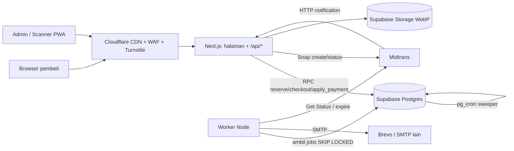
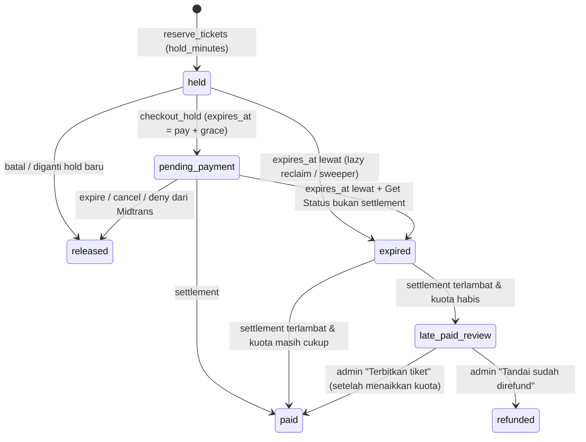

# PRD: Sistem Tiket Event Anti-Oversell

Dokumen ini adalah Product Requirements Document (PRD) aplikasi penjualan tiket event. Acuan produknya adalah alur booking Artatix, yang diamati langsung pada 16 Okt 2026 memakai Playwright dari langkah 1 sampai halaman pembayaran.

Ringkasan produk:
- Aplikasi penjualan tiket event untuk satu pengelola (single-tenant, satu peran admin).
- Pembeli tidak perlu login (guest).
- Stack: Node.js + Supabase (PostgreSQL), dengan Midtrans Snap sebagai satu-satunya payment gateway.

Tiga prinsip inti:
1. **Kuota hanya diubah oleh fungsi plpgsql yang atomik.** Cek dan pengurangan kuota terjadi dalam satu pernyataan, sehingga oversell mustahil terjadi.
2. **Slot dikunci di server sejak pembeli menekan "Beli Sekarang".** Countdown di layar berasal dari server. Artatix berbeda: di sana timer hanya ada di browser dan stok baru diambil saat pesanan dibuat.
3. **Semua batas waktu diselaraskan secara eksplisit:** kunci slot, batas bayar, dan expiry Midtrans.

Keputusan desain utama:
- Tanpa Redis dan tanpa ruang antre (waiting room).
- Kategori tiket berbentuk daftar datar seperti Artatix.
- Hanya data pemesan, tanpa data per pemegang tiket.
- Form builder dinamis per event.
- Semua pengaturan transaksi bersifat global.
- Hanya QRIS dan VA.
- Metode bayar dipilih di UI kita sendiri.

---

## 1. Ringkasan, tujuan, dan metrik keberhasilan

**Produk:** platform penjualan tiket event tunggal. Pembeli tidak perlu mendaftar. Setelah checkout, pembeli menerima tautan unik `/orders/{uuid}` yang berfungsi sebagai halaman pembayaran, status pesanan, dan e-ticket.

**Skala acuan MVP:** event terbesar sekitar 1.000 tiket, dengan sekitar 100 pengguna bersamaan di menit pertama penjualan.

| Tujuan | Ukuran keberhasilan MVP |
|---|---|
| Nol oversell, nol slot hilang permanen | Load test 300 virtual user menyerbu satu kategori tiket berkuota 100: `sold ≤ capacity` selalu terpenuhi; rekonsiliasi pasca-test menunjukkan drift `held`/`sold` = 0 |
| Booking responsif | p95 RPC kunci slot < 150 ms pada 100 pembeli bersamaan; TTFB halaman event dari CDN < 200 ms |
| Konfigurasi tanpa developer | Kategori event, event, kategori tiket, kuota, form, voucher, pengaturan transaksi, metode bayar, dan SMTP semuanya diatur dari panel |
| Ringan & modern | LCP < 2,5 detik di 4G untuk halaman event; gambar WebP; dark mode; indikator loading konsisten |

---

## 2. Ruang lingkup MVP dan non-scope

| Masuk MVP | Tidak masuk MVP |
|---|---|
| Event tunggal (satu tanggal/rentang), kategori event dinamis | Event bersesi, event berjadwal harian (pemilih tanggal), seat map |
| Daftar kategori tiket datar: harga, kuota, periode jual, batas per transaksi, tanda Merchandise, Bundle (isi N orang) | Hierarki Kelas → Tier |
| Kunci slot di server (default 3 menit) dengan auto-release; diperpanjang sampai batas bayar saat checkout | Ruang antre / waiting room, Redis |
| Data pemesan + form builder drag & drop per event (termasuk field Identitas: tipe + nomor diketik) | Data per pemegang tiket, upload foto KTP/identitas apa pun |
| Midtrans Snap: QRIS + Transfer Bank (VA), metode dipilih di UI kita | E-wallet langsung (OVO/DANA/dll.), kartu kredit, minimarket, paylater, gateway lain |
| Biaya layanan nominal tetap per transaksi (global) | Biaya per metode bayar atau persentase |
| Kode promo/voucher dengan kuota | Proses refund di sistem (refund hanya teks kebijakan per event dalam popup) |
| E-ticket QR per orang + scanner check-in (PWA, online) | Scanner offline, rotating QR, transfer tiket |
| Email transaksional via SMTP yang bisa diganti (Brevo default) | Notifikasi WhatsApp |
| Antarmuka Bahasa Indonesia | Multi-bahasa |
| Upload gambar → WebP otomatis, dark mode | Akun/login pembeli, multi-tenant, multi-role admin, waitlist, resale, tiket gratis |

---

## 3. Hasil pengamatan Artatix (16 Okt 2026)

Pengamatan dilakukan pada event `justice_run` (event tunggal) memakai Playwright, ditambah pembedahan bundle JavaScript dan respons API publik `api.artatix.co.id`.

| Aspek | Yang diamati di Artatix | Keputusan PRD |
|---|---|---|
| Langkah booking | Stepper 4 langkah: **1 Pilih Kategori → 2 Detail Pesanan → 3 Metode Pembayaran → 4 Pembayaran**, dengan modal "Konfirmasi Pesanan" di antara langkah 2 dan 3 | Ditiru (§8) |
| Pilih kategori | Kartu per kategori tiket (badge On Sale / Sold Out, tag "+ Merchandise" / "Bundle", deskripsi lipat), tombol "Pilih" → stepper qty, sidebar "Rincian Pesanan", tombol "Beli Sekarang" | Ditiru |
| Penguncian stok | "Beli Sekarang" hanya memanggil `POST /ticket/checkstock` tanpa hold. Timer 10 menit adalah state React (600 detik) di browser. Stok baru diambil saat `POST /transaction` di akhir | **Tidak ditiru.** Slot dikunci di server sejak "Beli Sekarang", default 3 menit (§10) |
| Data pemesan | Nama Lengkap, Tipe Identitas (KTP/SIM/Paspor/Kartu Pelajar), Nomor Identitas (diketik, maks 16), Email, No. WhatsApp (+62). Ada opsi event yang membatasi identitas hanya KTP | Ditiru: field tetap + field Identitas opsional dari form builder (§14) |
| Data per tiket | Bisa dinyalakan per event, dengan toggle "Samakan dengan detail pemesan". Field tambahan didefinisikan per kategori tiket | **Tidak ditiru.** Hanya data pemesan; field tambahan per event |
| Konfirmasi | Modal menampilkan ulang nama/email/WA + info bahwa invoice & e-ticket dikirim ke email tersebut; tombol "Edit Data" / "Saya Mengerti" | Ditiru; pengganti kewajiban mengetik email dua kali |
| Metode bayar | Dipilih di UI Artatix: accordion E-Wallet/QRIS (QRIS pertama) dan Transfer Bank. Metode diaktifkan per event | Ditiru, tetapi hanya QRIS + VA dan diatur global (§12) |
| Biaya layanan | Dihitung server (`POST /transaction/calculatetax`), Rp7.000 untuk tiket Rp135.000, tidak tergantung metode | Nominal tetap per transaksi, global, default Rp5.000 |
| Persetujuan | Dua checkbox: S&K dan Kebijakan Privasi & Pemrosesan Data. Tombol "Bayar Sekarang" nonaktif sampai keduanya dicentang | Ditiru |
| Promo | Tombol "Lebih hemat pakai promo" di sidebar | Ditiru |
| Halaman pembayaran | `/event/{slug}/ticket/{orderId}`: countdown 60 menit, batas bayar, metode, total, status PENDING, ID pesanan 12 hex, tombol "Bayar Sekarang" ke halaman checkout DOKU; status di-poll berulang | Ditiru dengan `/orders/{uuid}`, batas bayar 15 menit, dan Midtrans Snap |
| Model event | `event` (tunggal), `session` (event induk + event anak), `schedule` (pemilih tanggal) | MVP hanya event tunggal |
| Kategori event | Musik, Pameran, Teater, Olahraga, Wisata, Talkshow, Workshop, Kompetisi | Dipakai sebagai daftar awal |
| Halaman event | Tag kategori, judul, penyelenggara (nama + logo), media sosial, tab Deskripsi / Syarat & Ketentuan / Fasilitas (ikon), poster, Detail Acara (tanggal, jam, lokasi, peta), "Harga mulai dari", "Pesan Sekarang" | Ditiru + popup Kebijakan Refund |

---

## 4. Persona dan peran

| Persona | Akses | Kebutuhan utama |
|---|---|---|
| **Pembeli (guest)** | Publik, tanpa akun. Diidentifikasi oleh cookie `visitor_id` acak 128-bit (HttpOnly, Secure, SameSite=Lax, bertanda tangan) | Cepat memilih tiket, yakin slot aman selama mengisi form, menerima e-ticket, dan bisa membuka ulang lewat tautan pesanan |
| **Admin (single role)** | Panel `/admin`, login email + password dengan 2FA TOTP yang disarankan | Mengelola event, kuota, form, voucher, dan pengaturan; memantau penjualan; scan check-in |
| **Petugas gerbang** | Memakai akun admin (single role). Scanner berupa halaman di panel | Hasil scan hijau/merah yang cepat dan jelas |

---

## 5. Arsitektur dan tech stack

| Lapisan | Pilihan | Alasan |
|---|---|---|
| Web publik + panel admin + API | **Next.js (App Router) di Node.js**. UI dan API dalam satu aplikasi lewat route handlers `/api/*`; Tailwind dengan dark mode | Satu aplikasi Node, SSR/ISR untuk SEO dan cache CDN |
| Worker | Satu proses Node terpisah (`worker`) dalam repo yang sama | Kirim email, cek status Midtrans untuk order kedaluwarsa, rekonsiliasi |
| Database | Supabase PostgreSQL. Seluruh logika kuota berupa fungsi plpgsql | Atomik per panggilan |
| Koneksi DB dari Node | `postgres.js` lewat transaction pooler port 6543, `prepare: false`, pool kecil (10–20) | Transaction mode tidak mendukung prepared statement maupun LISTEN/NOTIFY |
| Penjadwal DB | Supabase Cron (pg_cron) untuk sweeper hold kedaluwarsa | Berjalan di DB tanpa server aplikasi |
| Antrean job | Tabel `jobs` di Postgres, diambil worker dengan `FOR UPDATE SKIP LOCKED` | Pengganti BullMQ/Redis; idempoten lewat `unique(dedupe_key)` |
| Storage | Supabase Storage, bucket publik untuk poster WebP | Ukuran gambar dibuat sendiri dengan sharp |
| Edge | Cloudflare (CDN, WAF, rate limiting rules, Turnstile) | Lonjakan didominasi baca halaman |
| Rate limit aplikasi | Limiter in-memory per proses di route handler sensitif | shortcut: hanya akurat untuk satu instance; pindah ke limiter berbasis Postgres/Cloudflare bila diskalakan horizontal |
| Pembayaran | Midtrans Snap via `midtrans-client` | `createTransaction`, `transaction.status/cancel/expire` |
| Email | nodemailer (SMTP apa pun), default Brevo | Provider bisa diganti dari panel |



**Hosting:** aplikasi Next.js dan worker berjalan di VPS/container yang dekat dengan region Supabase (Singapura disarankan). Webhook Midtrans wajib memakai HTTPS publik dengan sertifikat valid. Fungsi kunci slot dilarang memanggil HTTP, dan transaksinya harus singkat.

**Konvensi penamaan:** antarmuka berbahasa Indonesia. Semua nama teknis memakai bahasa Inggris dengan bentuk tunggal/jamak yang tepat:
- URL dan slug: `/events/{slug}`, `/orders/{uuid}`
- tabel: plural snake_case, misalnya `ticket_categories`
- kolom: snake_case
- file: kebab-case, misalnya `order-service.ts`
- service/kelas: PascalCase tunggal, misalnya `OrderService`
- endpoint: plural resource, misalnya `POST /api/holds`

---

## 6. Pengaturan global (Panel Admin → Pengaturan Transaksi)

Semua nilai berikut berlaku untuk seluruh event. Nilainya disimpan di tabel `settings` dan dibaca server pada setiap transaksi, bukan di-cache permanen.

| Key | Default | Keterangan |
|---|---|---|
| `hold_minutes` | 3 | Lama slot dikunci selama pembeli mengisi data dan memilih metode bayar. Rentang yang diizinkan: 1–30 |
| `pay_minutes` | 15 | Batas bayar setelah pesanan dibuat; juga dipakai sebagai expiry Midtrans. Rentang: 5–1440 |
| `pay_grace_minutes` | 5 | Cadangan setelah batas bayar sebelum slot dilepas (menampung notifikasi Midtrans yang terlambat). Tidak ditampilkan ke pembeli |
| `service_fee` | 5000 | Biaya layanan (Rp) **per transaksi**, berapa pun jumlah tiketnya. 0 = tanpa biaya |
| `payment_methods` | QRIS aktif; VA: semua bank yang didukung akun Midtrans aktif | Toggle QRIS dan toggle per bank VA |
| `smtp` | — | Host, port, user, password (terenkripsi, tidak pernah dikembalikan ke UI), alamat pengirim |
| `site` | — | Nama situs, logo, kontak CS (WA, email), teks S&K platform, teks Kebijakan Privasi |

Perubahan pengaturan hanya berlaku untuk hold dan pesanan **baru**. Hold dan pesanan yang sudah ada tetap memakai nilai yang tercatat saat dibuat (`expires_at`, `fee_amount`).

---

## 7. Model katalog

Hierarkinya **Kategori Event → Event → Kategori Tiket**.

Di database, setiap event juga punya satu `event_sessions` bawaan yang dibuat otomatis dan tidak tampil di UI. Kuota disimpan per (sesi × kategori tiket) di `ticket_inventory`. Dengan begitu, event bersesi bisa ditambahkan nanti tanpa mengubah fungsi kuota.

**Kategori event awal (dinamis; admin bisa menambah, menyembunyikan, mengurutkan, memberi ikon):**

| Label | Slug |
|---|---|
| Musik | `music` |
| Pameran | `exhibition` |
| Teater | `theater` |
| Olahraga | `sports` |
| Wisata | `tourism` |
| Talkshow | `talkshow` |
| Workshop | `workshop` |
| Kompetisi | `competition` |

**Kategori tiket (daftar datar, seperti Artatix):**

| Atribut | Keterangan |
|---|---|
| `name` | Nama bebas, misalnya "BATCH 2 - Mahasiswa", "Presale VIP", "Bundling Couple" |
| `description` | Teks kaya opsional, tampil sebagai "Deskripsi" yang bisa dilipat |
| `price` | Rupiah, bilangan bulat ≥ 1.000 (tiket gratis di luar MVP) |
| `capacity` | Kuota dalam **unit yang dijual** (di `ticket_inventory`). 50 unit Bundle Couple = 50 pembelian = 100 QR |
| `sale_starts_at`, `sale_ends_at` | Periode jual. Di luar periode: badge "Segera dibuka" atau "Penjualan ditutup" |
| `max_per_order` | Batas qty kategori ini dalam satu transaksi (default 5) |
| `has_merchandise` | Hanya badge "+ Merchandise". Detail seperti ukuran baju diminta lewat form builder event |
| `admits_per_unit` | Default 1. Bundle = N (Couple 2, Family 4); badge "Bundle"; 1 unit menerbitkan N QR |
| `status` | `draft` / `active` / `hidden` |
| `position` | Urutan tampil |

Status tampilan di kartu tiket: **On Sale**, **Hampir habis** (sisa ≤ 10% atau ≤ 10 unit), **Sold Out**, **Segera dibuka**, **Penjualan ditutup**.

Aturan bisnis katalog:
- Kapasitas tidak boleh diturunkan di bawah `sold + held`, dijaga oleh constraint.
- Kategori tiket yang sudah terjual tidak boleh dihapus, hanya disembunyikan.
- Satu pesanan boleh berisi beberapa kategori tiket dari event yang sama.
- Setiap kategori dibatasi `max_per_order`-nya sendiri.

---

## 8. Alur booking publik

Stepper di header: **1 Pilih Tiket → 2 Detail Pesanan → 3 Metode Pembayaran → 4 Pembayaran**.

| Langkah | Layar / aksi | Sistem |
|---|---|---|
| 0a | **Beranda** `/`: event rekomendasi, kategori event, event terdekat. **Jelajah** `/events?category={slug}&q=`: kartu event (poster, judul, tanggal, "Mulai dari Rp…", penyelenggara) | Halaman di-cache CDN |
| 0b | **Detail event** `/events/{slug}`: tag kategori, judul, penyelenggara, media sosial, tab Deskripsi / Syarat & Ketentuan / Fasilitas, tautan "Kebijakan Refund" (popup), poster, Detail Acara, "Harga mulai dari", tombol **"Pesan Sekarang"** | Di-cache CDN |
| 1 | **Pilih Tiket** `/events/{slug}/tickets`: kartu kategori tiket dengan badge status. Tombol "Pilih" → stepper qty (maks `max_per_order` dan sisa stok perkiraan). Sidebar "Rincian Pesanan" (item, subtotal, total item). Tombol **"Beli Sekarang"** | `POST /api/holds` (Turnstile + `Idempotency-Key`) → RPC `reserve_tickets`. Berhasil: hold sepanjang `hold_minutes`, lalu redirect ke `/checkout/{holdId}`. Gagal: pesan "Kuota {nama} tidak cukup, sisa {n}" dan qty disesuaikan |
| 2 | **Detail Pesanan** `/checkout/{holdId}`: ringkasan event. Kartu "Data Pemesan": Nama Lengkap, Email, No. WhatsApp + field dinamis event. Countdown **"Batas Waktu Tersisa"** di sidebar. Tombol kembali (‹) dan **"Lanjutkan"** | Countdown memakai `expires_at` dari server. Draf form disimpan di `sessionStorage`. Validasi klien, lalu validasi server saat checkout |
| 2b | **Modal "Konfirmasi Pesanan"**: nama, email, WA, dan "Informasi Penting" (invoice dan e-ticket dikirim ke email ini; cek folder spam bila belum masuk). Tombol "Edit Data" / "Saya Mengerti" | Tanpa panggilan server |
| 3 | **Metode Pembayaran** (masih di `/checkout/{holdId}`): accordion **QRIS** dan **Transfer Bank** (logo bank yang aktif). Sidebar: item, subtotal, diskon voucher, **Biaya Layanan**, Total Bayar, tombol "Lebih hemat pakai promo" (modal input kode), checkbox S&K, checkbox Kebijakan Privasi & Pemrosesan Data, tombol **"Bayar Sekarang"** (nonaktif sampai metode dipilih dan kedua checkbox dicentang) | `POST /api/holds/{id}/quote` menghitung total di server (dengan voucher opsional) |
| 4 | **"Bayar Sekarang"** | `POST /api/holds/{id}/checkout` → RPC `checkout_hold`: validasi data, buat order + invoice, voucher di-hold, hold → `pending_payment`, `expires_at` = sekarang + `pay_minutes` + `pay_grace_minutes`. Lalu Snap dipanggil dengan `enabled_payments` = metode terpilih dan `expiry.start_time` = waktu checkout. Redirect ke `/orders/{uuid}`, email "Menunggu pembayaran" diantrekan |
| 5 | **Halaman pesanan** `/orders/{uuid}`: bar "Selesaikan Pembayaran" + countdown, kalimat "Silakan lakukan pembayaran sebelum {tanggal jam}", metode, total, Status (PENDING / LUNAS / KEDALUWARSA / DIBATALKAN), ID Pesanan (invoice), tombol **"Bayar Sekarang"** yang membuka popup Snap, dan ringkasan event. Popup Snap terbuka otomatis sekali pada kunjungan pertama | Polling `GET /api/orders/{uuid}` tiap 5 detik selama status pending. Status final hanya dari webhook/Get Status |
| 6 | Setelah lunas, halaman yang sama menampilkan **e-ticket**: QR per orang (`admits_per_unit` × qty), nama pemesan, kategori tiket, tombol unduh PDF. Email "Pembayaran berhasil" berisi tautan ini | Job email idempoten |

Kasus gagal yang wajib ditangani di UI:

| Kasus | Perilaku |
|---|---|
| Waktu hold habis di langkah 2–3 | Modal "Waktu habis, slot dilepas" + tombol "Pilih ulang tiket". Isi form tetap tersimpan di `sessionStorage` |
| Tombol kembali (‹) di langkah 2 | Konfirmasi "Batalkan pilihan tiket?" → `DELETE /api/holds/{id}` → kembali ke langkah 1 dengan qty sebelumnya terisi |
| Pembeli kembali ke langkah 1 dan menekan "Beli Sekarang" lagi saat hold lama masih `held` | Hold lama dilepas dan diganti hold baru dalam transaksi yang sama. Hold `pending_payment` tidak tersentuh |
| Voucher habis/tidak valid | Pesan di modal promo; pembeli tetap bisa bayar tanpa voucher |
| Double-click "Beli Sekarang"/"Bayar Sekarang" | `Idempotency-Key` yang sama mengembalikan hold/order yang sama |
| Popup Snap ditutup | Tombol "Bayar Sekarang" membuka ulang token Snap yang sama selama order masih pending |
| Batas bayar lewat | Status KEDALUWARSA, tautan "Pesan lagi" ke halaman event |

---

## 9. State machine hold dan order



| Status order | Arti | Pemicu |
|---|---|---|
| `awaiting_payment` | Menunggu Midtrans | `checkout_hold` |
| `paid` | E-ticket terbit | `apply_payment_status` settlement |
| `expired` | Tidak dibayar dalam batas waktu | webhook expire / worker |
| `cancelled` | Dibatalkan admin sebelum bayar | aksi admin |
| `late_paid_review` | Uang masuk setelah slot habis | Daftar tindak lanjut admin. Dua aksi: **"Terbitkan tiket"** (admin menaikkan kuota dulu, lalu aksi ini menjalankan pengecekan kuota normal dan menerbitkan tiket + email) atau **"Tandai sudah direfund"** (setelah refund manual di dashboard Midtrans) |
| `refunded` | Dana dikembalikan di luar sistem | aksi admin dari `late_paid_review` |

Semua transisi berbentuk `UPDATE ... WHERE status IN (...)`, sehingga notifikasi duplikat atau tidak berurutan otomatis menjadi no-op.

QRIS dan VA tidak mengalami pembalikan settlement → deny seperti kartu kredit, sehingga tidak ada status `revoked`.

---

## 10. Core engine: penguncian slot tanpa oversell dan tanpa bocor

### 10.1 Prinsip

Ketersediaan dihitung sebagai `capacity − sold − held` pada baris `ticket_inventory`.

Aturan perubahan `held`:
- `held` hanya berubah di dalam fungsi plpgsql yang dipanggil server dengan service role.
- Hak `execute` dicabut dari `anon`/`authenticated`.
- Fungsi `security definer` memakai `search_path = ''`.

Kolom `hold_items.counted` menandai apakah qty item masih dihitung dalam `held`. Invarian yang dijaga: `held(inv) = SUM(qty) hold_items WHERE inventory_id = inv AND counted`.

Setiap pelepasan memproses item satu per satu dengan urutan `inventory_id` naik untuk mencegah deadlock.

### 10.2 Sketsa fungsi reserve

```sql
create or replace function public.reclaim_expired(p_inv bigint) returns int
language plpgsql volatile security definer set search_path = '' as $$
declare v_freed int;
begin
  with exp as (
    update public.hold_items hi set counted = false
      from public.holds h
     where hi.hold_id = h.id and hi.inventory_id = p_inv and hi.counted
       and h.status in ('held','pending_payment') and h.expires_at < now()
    returning hi.qty)
  select coalesce(sum(qty),0) into v_freed from exp;
  if v_freed > 0 then
    update public.ticket_inventory set held = held - v_freed where id = p_inv;
  end if;
  return v_freed;
end $$;

create or replace function public.reserve_tickets(
  p_visitor uuid, p_event_id bigint, p_items jsonb, p_idem text)
returns public.holds
language plpgsql volatile security definer set search_path = '' as $$
declare
  v_hold    public.holds;
  v_minutes int;
  v_session bigint;
  r         record;
begin
  select * into v_hold from public.holds
   where visitor_id = p_visitor and idempotency_key = p_idem;
  if found then return v_hold; end if;

  select s.id into v_session
    from public.event_sessions s join public.events e on e.id = s.event_id
   where e.id = p_event_id and e.status = 'published' and s.status = 'on_sale'
   limit 1;
  if v_session is null then raise exception 'NOT_ON_SALE' using errcode = 'P0001'; end if;

  select (value #>> '{}')::int into v_minutes from public.settings where key = 'hold_minutes';

  perform public.release_hold_internal(h.id)
     from public.holds h
    where h.visitor_id = p_visitor and h.event_id = p_event_id and h.status = 'held';

  insert into public.holds(visitor_id, event_id, session_id, idempotency_key, status, expires_at)
  values (p_visitor, p_event_id, v_session, p_idem, 'held', now() + make_interval(mins => v_minutes))
  returning * into v_hold;

  for r in
    select (x->>'inventory_id')::bigint as inv, (x->>'qty')::int as qty
      from jsonb_array_elements(p_items) x order by 1
  loop
    perform public.reclaim_expired(r.inv);
    update public.ticket_inventory i
       set held = held + r.qty
      from public.ticket_categories c
     where i.id = r.inv and i.session_id = v_session and c.id = i.ticket_category_id
       and c.status = 'active' and now() between c.sale_starts_at and c.sale_ends_at
       and r.qty between 1 and c.max_per_order
       and i.capacity - i.sold - i.held >= r.qty;
    if not found then
      raise exception 'SOLD_OUT:%', r.inv using errcode = 'P0001';
    end if;
    insert into public.hold_items(hold_id, inventory_id, qty, unit_price, counted)
    select v_hold.id, r.inv, r.qty, c.price, true
      from public.ticket_inventory i join public.ticket_categories c on c.id = i.ticket_category_id
     where i.id = r.inv;
  end loop;

  return v_hold;
end $$;
```

`SOLD_OUT` membuat seluruh transaksi rollback, termasuk pelepasan hold lama dan hasil `reclaim_expired`. Ini aman: tidak oversell dan tidak ada slot yang bocor permanen. Sweeper akan mengambil slot itu dalam ≤15 detik. Server membedakan "qty melebihi batas" dari "kuota habis" dengan memeriksa `max_per_order` sebelum memanggil RPC.

### 10.3 Checkout, lunas, dan lepas

| Fungsi | Inti logika |
|---|---|
| `checkout_hold(hold_id, visitor, buyer jsonb, answers jsonb, payment_method, voucher_code, idem)` | `UPDATE holds SET status='pending_payment', expires_at = now() + pay_minutes + pay_grace_minutes WHERE id=$1 AND visitor_id=$2 AND status='held' AND expires_at > now()`. Bila 0 baris, hold sudah habis. Dalam transaksi yang sama: hold voucher (§13), hitung subtotal/diskon/`service_fee`/total di server, buat `orders` (invoice, `public_uuid`, snapshot `fee_amount`, `pay_expires_at`), simpan jawaban form, buat `payments` (attempt 1, metode), simpan `consents` |
| `apply_payment_status(midtrans_order_id, status, payload)` | Settlement: untuk tiap item `counted`, `held -= qty, sold += qty, counted = false`. Pembayaran terlambat (item sudah di-reclaim) diproses **semua-atau-tidak-sama-sekali per order**: setiap item dicoba `UPDATE ticket_inventory SET sold = sold + qty WHERE capacity - sold - held >= qty`. Bila satu item gagal, seluruh perubahan `sold` di-rollback (savepoint) dan order masuk `late_paid_review`. Bila semua berhasil, order menjadi `paid`. Voucher pada pembayaran terlambat tetap dihormati walau `used` melewati `max_uses`, karena uang sudah dibayar dengan harga diskon. Lalu terbitkan `tickets` dan antrekan email. Expire/cancel/deny: lepas item `counted` hanya bila hold berstatus `pending_payment` |
| `release_hold(hold_id, visitor)` | Pembeli menekan kembali/batal di langkah 2–3 |
| `sweep_expired_holds()` | pg_cron tiap 15 detik: ambil ≤1.000 hold kedaluwarsa dengan `FOR UPDATE SKIP LOCKED`, reclaim item, set status `expired`. Hold `pending_payment` yang kedaluwarsa juga diberi job `payment-check` untuk worker |

### 10.4 Lapisan expiry

| Lapis | Mekanisme | Peran |
|---|---|---|
| 1 | Lazy reclaim di dalam `reserve_tickets` | **Kebenaran.** Timer yang terlewat tidak membuat slot hilang permanen |
| 2 | Sweeper pg_cron tiap 15 detik | Kesegaran angka ketersediaan |
| 3 | Worker job `payment-check` | Panggil Midtrans Get Status untuk order pending yang lewat batas. Bila masih pending, panggil `expire` dulu, baru lepas slot |
| 4 | Rekonsiliasi per jam (worker) | `held` dibandingkan dengan SUM item `counted`, dan `sold` dengan SUM item lunas. Drift memicu alert dan koreksi. Juga mem-poll payment pending yang lebih tua dari `pay_minutes + 10` menit |

---

## 11. Perlindungan saat ramai (pengganti ruang antre)

Dengan skala acuan ±100 pengguna bersamaan, MVP **tidak memakai ruang antre maupun Redis**. Perlindungan yang dipakai:

| Kontrol | Implementasi |
|---|---|
| Anti-oversell | Fungsi atomik §10, tidak bergantung pada antrean |
| Anti-bot | Cloudflare Turnstile pada "Beli Sekarang" (`POST /api/holds`) dan "Bayar Sekarang" (`POST /api/holds/{id}/checkout`), diverifikasi server-side |
| Rate limit | Cloudflare rate limiting rules untuk `/api/*` + limiter in-memory per visitor/IP di `POST /api/holds` (mis. 10/menit). Longgar per IP karena CGNAT seluler |
| Satu hold aktif | Satu hold `held` per visitor per event (hold baru menggantikan yang lama) |
| Beban baca | Halaman event dan daftar tiket di-cache CDN; endpoint ketersediaan di-cache mikro 2–5 detik |

Ruang antre dipindahkan ke roadmap "fase berikutnya" untuk event yang jauh lebih besar.

---

## 12. Integrasi Midtrans

| Aspek | Spesifikasi |
|---|---|
| Metode | QRIS dan Transfer Bank (VA), dipilih pembeli di langkah 3. Snap dipanggil dengan `enabled_payments` berisi **satu** metode terpilih, sehingga popup langsung menampilkan instruksi metode tersebut. Kode Midtrans (`other_qris`, `bca_va`, `bni_va`, `bri_va`, `echannel`, `permata_va`, `cimb_va`, dll.) **wajib diverifikasi di sandbox** sebelum dipakai |
| Daftar bank | Mengikuti toggle global `payment_methods`. Bank yang tidak didukung akun Midtrans tidak ditampilkan di panel |
| Pembuatan transaksi | Server-side `POST /snap/v1/transactions`. `item_details` per kategori tiket + baris diskon (negatif) + baris "Biaya Layanan". Jumlahnya wajib sama dengan `gross_amount` (IDR tanpa desimal) |
| `order_id` Midtrans | Per percobaan: `{invoice}-{attempt}`, misalnya `H68B17E09-1`. Satu `order_id` hanya bisa dipakai sekali |
| Expiry | `expiry: {start_time: "<checkout> +0700", unit: "minute", duration: pay_minutes}` dan `page_expiry` yang sama. Expiry per metode di Snap Preferences diset ≥ nilai ini agar tidak memotong lebih awal |
| Popup ditutup | `snap_token` disimpan di `payments`. Selama order pending, token yang sama dibuka ulang. Ganti metode setelah order dibuat **tidak** didukung di MVP |
| Webhook | `POST /api/webhooks/midtrans`: (1) verifikasi `SHA512(order_id+status_code+gross_amount+ServerKey)` dengan perbandingan waktu-konstan; (2) panggil Get Status sebagai sumber kebenaran; (3) simpan payload ke `payment_events` (unik per `order_id, transaction_status, transaction_id`); (4) RPC `apply_payment_status`; (5) balas 200 dalam < 5 detik, termasuk untuk duplikat dan order tak dikenal |
| Kriteria lunas | `transaction_status` = `settlement` dengan `status_code` 200 |
| Tanpa webhook | Snap tidak mengirim webhook saat halamannya kedaluwarsa. Worker `payment-check` dan rekonsiliasi mem-poll Get Status |
| Pembayaran terlambat | Bila kuota masih cukup, pesanan dihormati (`paid`). Bila tidak, `late_paid_review` + alert admin + email ke pembeli bahwa dana akan dikembalikan oleh pengelola. `sold` tidak pernah dipaksa melewati kapasitas |
| Lingkungan | Key dan URL notifikasi sandbox/produksi dipisah lewat env; server key tidak disimpan di DB |

---

## 13. Promo dan voucher

| Atribut | Spesifikasi |
|---|---|
| Tipe | `percent` (dengan `max_discount`) atau `fixed` (Rp) |
| Cakupan | Event tertentu; opsional kategori tiket tertentu |
| Syarat | `min_qty`, `min_subtotal`, `valid_from`/`valid_to`, `max_uses` (kuota global), `active` |
| Dasar diskon | Subtotal tiket saja; biaya layanan tidak didiskon. Total tiket setelah diskon minimal Rp1.000 |
| Kuota | Counter `used` + `held` di `vouchers`, dengan `CHECK (used + held <= max_uses)`. Voucher di-hold dalam transaksi `checkout_hold` yang sama, lalu dilepas/dikonfirmasi oleh transisi yang sama dengan hold tiket |
| Batas | Satu voucher per order; tidak ada batas per pembeli di MVP |
| Kode | Case-insensitive, unik per event; generator kode massal |

---

## 14. Form builder per event dan kepatuhan PDP

**Field tetap pemesan (selalu ada, tidak bisa dihapus):** Nama Lengkap, Email, No. WhatsApp (pemilih kode negara, default +62, dinormalisasi ke format `62…`).

**Field tambahan** disusun admin per event lewat form builder drag & drop. Semua field tambahan bersifat opsional untuk dipasang: event yang tidak butuh field tambahan cukup memakai field tetap. Field diisi **sekali per pesanan** dan berlaku untuk semua kategori tiket di event tersebut.

| Tipe field | Tampilan | Validasi yang bisa diatur |
|---|---|---|
| `short_text` | Input satu baris | wajib, min/maks panjang, regex |
| `long_text` | Textarea | wajib, maks panjang |
| `number` | Input angka | wajib, min/maks |
| `date` | Pemilih tanggal | wajib, min/maks, `min_age` |
| `select` | Dropdown | wajib; opsi label/value |
| `radio` | Pilihan tunggal | wajib; opsi |
| `checkbox` | Pilihan ganda | wajib, min/maks pilihan; opsi |
| `chips` | Tombol pilihan tunggal, misalnya ukuran baju XS–XXXL atau Jenis Kelamin | wajib; opsi |
| `identity` | Dropdown "Tipe Identitas" + input "Nomor Identitas" (**diketik, tanpa upload**) | wajib; tipe yang diizinkan (KTP, SIM, Paspor, Kartu Pelajar; bisa "hanya KTP"); KTP = tepat 16 digit angka; tipe lain 5–20 karakter alfanumerik |

Properti setiap field: `key` (otomatis dari label, bahasa Inggris snake_case, bisa diedit), `label`, `help_text`, `placeholder`, `required`, `position` (drag & drop), `is_active`. Panel menyediakan pratinjau form. Field yang sudah punya jawaban tidak boleh dihapus, hanya dinonaktifkan. Validasi berjalan di klien (UX) dan di server; skema dibangun dari definisi field dan server menjadi sumber kebenaran.

**Identitas dan UU PDP.** Nomor identitas adalah data pribadi. Kontrol yang diterapkan:

| Kontrol | Implementasi |
|---|---|
| Minimisasi | Nomor identitas hanya diminta bila admin memasang field `identity` di event tersebut; tidak ada upload foto identitas |
| Persetujuan | Checkbox "Kebijakan Privasi & Pemrosesan Data" di langkah 3. Bila event memiliki field `identity`, label checkbox menyebut tujuannya ("verifikasi identitas pemesan saat check-in") dan masa simpannya. Satu nomor identitas berlaku untuk seluruh pesanan, karena MVP hanya mengumpulkan data pemesan. Disimpan di `consents(order_id, policy_version, purpose, ip, created_at)` |
| Penyimpanan | Nomor identitas dienkripsi di aplikasi (AES-256-GCM, kunci di env, bukan di DB) |
| Penyamaran | `3201********0001` di panel, email, PDF, ekspor, dan log. **Tidak pernah dimasukkan ke QR.** Buka penuh lewat tombol yang tercatat di audit log |
| Retensi | Nomor identitas dihapus otomatis 60 hari setelah event berakhir (pg_cron) |

---

## 15. E-ticket QR dan check-in

| Aspek | Spesifikasi |
|---|---|
| Granularitas | Satu QR per orang: `admits_per_unit` × qty. Bundle Couple ×1 = 2 QR. Semua atas nama pemesan, diberi nomor urut ("Tiket 1 dari 2") |
| Payload | Token acak opaque 128-bit (base64url) yang dicari di server. Tanpa data pribadi |
| Penerbitan | Saat order `paid`. Tampil di `/orders/{uuid}` dan PDF unduhan. Email berisi tautan, bukan gambar QR inline |
| Validasi | Online dan atomik: `UPDATE tickets SET checked_in_at = now(), checked_in_by = $admin, gate = $g WHERE token_hash = $1 AND checked_in_at IS NULL AND status = 'valid' RETURNING *`. Nol baris berarti tampil "SUDAH DIPAKAI pukul 19:02, Gate B" atau "TIDAK VALID" |
| Scanner | Halaman PWA di panel admin: kamera belakang, `BarcodeDetector` native dengan fallback pustaka JS yang masih dipelihara, layar hijau/merah penuh, getar/suara, debounce 1–2 detik, input kode manual, pilihan gate. Layar hijau menampilkan nama pemesan, kategori tiket, "Tiket 1 dari N", dan nomor identitas tersamar (bila ada) agar petugas bisa mencocokkan dengan kartu identitas |
| Audit | `checkin_events` mencatat semua scan, termasuk yang ditolak |

---

## 16. Panel admin

| Modul | Fitur |
|---|---|
| Dasbor | Penjualan per event/kategori tiket, pendapatan bruto/diskon/biaya layanan, hold aktif |
| Kategori Event | CRUD, urutan, ikon, sembunyikan |
| Event | CRUD; slug kebab-case otomatis dari judul (bisa diedit, riwayat slug + redirect 301); poster (WebP); deskripsi rich text; S&K; fasilitas (checklist ikon: area parkir, toilet, medis, musholla, food court, photo booth, area merokok, water station, penyimpanan, pusat informasi, merchandise, charging station, akses disabilitas, area anak); **kebijakan refund** (teks popup); tanggal & jam mulai/selesai; lokasi, kota, provinsi, tautan peta; penyelenggara (nama + logo); media sosial; status draft/published/archived; status penjualan on_sale/paused/closed; SEO meta |
| Kategori Tiket | CRUD per event (§7), urutan drag & drop, kuota dengan tampilan terjual/di-hold/tersedia |
| Form Builder | Drag & drop field per event (§14), pratinjau |
| Voucher | CRUD, generator massal, statistik pemakaian |
| Pesanan | Cari (invoice, email, nama, UUID), detail, kirim ulang email (termasuk ke email terkoreksi), batalkan order belum bayar, daftar `late_paid_review`, ekspor CSV (identitas disamarkan) |
| Check-in | Scanner, riwayat scan, statistik kehadiran per kategori tiket |
| Pengaturan Transaksi | §6: `hold_minutes`, `pay_minutes`, `service_fee`, toggle QRIS & bank VA |
| Pengaturan Situs & Email | Identitas situs, kontak CS, teks S&K & Kebijakan Privasi platform; SMTP + tombol "kirim email uji"; templat email |
| Admin & Audit | Kelola akun admin, 2FA, audit log semua perubahan |

---

## 17. Halaman publik dan UX

| Area | Spesifikasi |
|---|---|
| Routing | `/`, `/events`, `/events/{slug}`, `/events/{slug}/tickets`, `/checkout/{holdId}`, `/orders/{uuid}`, `/admin/*`. Halaman pesanan bersifat global dan **tidak** bersarang di bawah slug event (berbeda dari Artatix `/event/{slug}/ticket/{orderId}`): satu pola `/orders/{uuid}` untuk semua event, dan nama event cukup tampil di isi halaman |
| SEO | SSR/ISR, meta OG, JSON-LD `Event`, sitemap. `/checkout/*` dan `/orders/*` diberi `noindex, nofollow` |
| Cache | Halaman event `Cache-Control: public, s-maxage=30–60, stale-while-revalidate=300` tanpa data pengguna. Endpoint ketersediaan di-cache mikro 2–5 detik. `/api/holds*`, `/api/orders*`, `/checkout/*` memakai `no-store` |
| Gambar | Upload dikonversi ke WebP dengan sharp (`rotate()` → `resize` tanpa memperbesar → `webp({quality: 80})`). Ukuran `lg` 1600, `md` 800, `thumb` 400 px. Batas upload 10 MB dengan cek magic bytes. `srcset` + lazy load |
| Dark mode | Token warna CSS terang/gelap, mengikuti sistem secara default, toggle manual disimpan di `localStorage`, tanpa flash saat load. Kontras WCAG AA; QR selalu di latar putih |
| Loading | Skeleton untuk kartu event dan daftar tiket. Spinner di dalam tombol aksi dengan tombol nonaktif. Timeout 15 detik memunculkan pesan dan tombol coba lagi |
| Countdown | Sidebar langkah 2–3 ("Batas Waktu Tersisa") dan bar atas halaman pesanan. Warna berubah di < 60 detik. Bersumber dari `expires_at` server |
| Aksesibilitas | Navigasi keyboard, label form, pesan error di samping field |

---

## 18. Notifikasi email

| Email | Pemicu | Isi |
|---|---|---|
| Menunggu pembayaran | `checkout_hold` sukses | Invoice, rincian, batas bayar, tautan `/orders/{uuid}` |
| Pembayaran berhasil / e-ticket | `paid` | Tautan e-ticket, ringkasan, info venue, kebijakan refund |
| Pesanan kedaluwarsa | `expired` | Info bahwa pesanan batal; tautan event |
| Pembayaran terlambat | `late_paid_review` | Permintaan maaf; pengelola akan menghubungi untuk pengembalian dana |

**Desain teknis.** Interface `EmailProvider.send()` dengan implementasi `SmtpProvider` (nodemailer). Konfigurasi diambil dari `settings.smtp`, dengan env sebagai fallback. Setiap email menjadi baris di `jobs` dengan `dedupe_key = email:{type}:{order_id}`, sehingga webhook berulang tidak mengirim email ganda. Worker mencoba ulang hingga 5 kali dengan backoff eksponensial. Semua pengiriman tercatat di `email_logs`.

**Kapasitas.** Paket gratis Brevo hanya 300 email/hari. Untuk event 1.000 tiket dengan 2–3 email per pesanan, paket berbayar diperlukan saat peluncuran. Domain pengirim wajib diautentikasi (DKIM, DMARC).

---

## 19. Skema database

| Tabel | Kolom kunci | Constraint / indeks |
|---|---|---|
| `event_categories` | id, name, slug, icon, position, is_active | `unique(slug)` |
| `events` | id, event_category_id, title, slug, description, terms, facilities text[], refund_policy, starts_at, ends_at, timezone (default `Asia/Jakarta`; pilihan WIB/WITA/WIT), venue, city, province, map_url, organizer_name, organizer_logo_path, social_links jsonb, poster_path, status, sale_status, seo jsonb | `unique(slug)`, indeks (status, event_category_id) |
| `slug_redirects` | old_slug, event_id | `unique(old_slug)` |
| `event_sessions` | id, event_id, starts_at, ends_at, status | Satu baris bawaan per event di MVP |
| `ticket_categories` | id, event_id, name, description, price bigint, max_per_order, admits_per_unit, has_merchandise, sale_starts_at, sale_ends_at, status, position | `check(price >= 1000)`, `check(max_per_order between 1 and 50)`, `check(admits_per_unit >= 1)` |
| `ticket_inventory` | id, session_id, ticket_category_id, capacity, sold, held | `unique(session_id, ticket_category_id)`, `check(sold>=0 and held>=0 and sold+held<=capacity)` |
| `form_fields` | id, event_id, key, label, type, options jsonb, validation jsonb, help_text, placeholder, required, position, is_active | `unique(event_id, key)` |
| `holds` | id uuid, visitor_id uuid, event_id, session_id, status, expires_at, idempotency_key, created_at | `unique(visitor_id, idempotency_key)`; partial unique `(visitor_id, event_id) where status = 'held'`; indeks `(expires_at) where status in ('held','pending_payment')` |
| `hold_items` | id, hold_id, inventory_id, qty, unit_price, counted bool | `check(qty>0)`, indeks `(inventory_id) where counted` |
| `orders` | id, public_uuid uuid, invoice_code, hold_id, event_id, buyer_name, buyer_email, buyer_phone, subtotal, discount_amount, fee_amount, total, voucher_id, voucher_counted bool, payment_method, status, pay_expires_at, paid_at, created_at | `unique(public_uuid)`, `unique(invoice_code)`, `unique(hold_id)`, indeks (buyer_email), (status, created_at) |
| `order_answers` | order_id, form_field_id, value jsonb (non-PII), value_encrypted bytea (field `identity`) | `unique(order_id, form_field_id)` |
| `consents` | order_id, policy_version, purpose, ip, created_at | — |
| `payments` | id, order_id, attempt, midtrans_order_id, payment_method, snap_token, redirect_url, status, gross_amount, expires_at, raw_last jsonb | `unique(midtrans_order_id)`, `unique(order_id, attempt)` |
| `payment_events` | id, midtrans_order_id, transaction_status, transaction_id, payload jsonb, received_at | `unique(midtrans_order_id, transaction_status, transaction_id)` |
| `vouchers` | id, event_id, code, type, value, max_discount, min_qty, min_subtotal, ticket_category_ids bigint[], valid_from, valid_to, max_uses, used, held, active | `unique(event_id, lower(code))`. Batas `used + held <= max_uses` ditegakkan di `UPDATE` bersyarat saat hold voucher, bukan sebagai `CHECK`, agar pembayaran terlambat bisa dihormati (§10.3) |
| `tickets` | id, order_id, ticket_category_id, seq, token_hash, status (valid/void), checked_in_at, checked_in_by, gate | `unique(token_hash)` |
| `checkin_events` | id, ticket_id null, token_hash, admin_id, gate, result, created_at | indeks (created_at) |
| `jobs` | id, type, payload jsonb, dedupe_key, run_at, attempts, status, last_error, created_at | `unique(dedupe_key)`, indeks `(run_at) where status = 'queued'` |
| `admins` | id, email, password_hash, totp_secret_enc, is_active | `unique(email)` |
| `settings` | key, value jsonb, secret_enc bytea | `primary key(key)` |
| `email_logs` | id, order_id, type, to, message_id, status, error, created_at | — |
| `audit_logs` | id, admin_id, action, entity, entity_id, diff jsonb, created_at | indeks (entity, entity_id) |

**Invoice.** `invoice_code` terdiri dari huruf prefiks + 8 karakter acak base32 Crockford huruf besar (misalnya `H68B17E09`), dibuat di DB dengan retry bila bentrok. Kode ini mudah dibacakan ke CS, tetapi **bukan** kunci akses. Akses pesanan hanya lewat `public_uuid` (UUID v4).

**RLS** aktif di semua tabel tanpa policy untuk `anon`. Seluruh akses publik lewat API server dengan service role.

---

## 20. Daftar endpoint API

| Metode & path | Guard | Fungsi |
|---|---|---|
| `GET /api/event-categories`, `GET /api/events?category=&q=&page=` | publik, cache | Katalog |
| `GET /api/events/{slug}` | publik, cache | Detail event + kategori tiket + form fields aktif |
| `GET /api/events/{slug}/availability` | publik, cache 2–5 detik | Status per kategori tiket (badge, sisa perkiraan) |
| `POST /api/holds` | Turnstile, rate limit, `Idempotency-Key` | RPC `reserve_tickets` |
| `GET /api/holds/{id}` | visitor pemilik | Sisa waktu, item, form fields, metode bayar aktif, biaya layanan |
| `DELETE /api/holds/{id}` | visitor pemilik | `release_hold` |
| `POST /api/holds/{id}/quote` | visitor pemilik | Hitung subtotal, diskon voucher (opsional), biaya layanan, total |
| `POST /api/holds/{id}/checkout` | visitor pemilik, Turnstile, `Idempotency-Key` | `checkout_hold` → Snap → `{orderUuid}` |
| `GET /api/orders/{uuid}` | UUID saja, rate limit, `Referrer-Policy: no-referrer` | Status, batas bayar, `snap_token` (bila pending), e-ticket (bila lunas) |
| `GET /api/orders/{uuid}/tickets.pdf` | UUID | PDF e-ticket |
| `POST /api/webhooks/midtrans` | signature + Get Status | `apply_payment_status` |
| `POST /api/admin/auth/login`, `/logout`, `/2fa` | — | Auth admin |
| `/api/admin/event-categories`, `/events`, `/events/{id}/ticket-categories`, `/events/{id}/form-fields`, `/vouchers` | admin | CRUD |
| `POST /api/admin/uploads` | admin | Upload → WebP |
| `GET /api/admin/orders`, `GET /api/admin/orders/{id}`, `POST .../resend-email`, `POST .../cancel`, `GET /api/admin/orders/late-paid` | admin | Pesanan |
| `POST /api/admin/check-ins` | admin, rate limit | Validasi QR atomik |
| `GET/PUT /api/admin/settings/{group}` (`transaction`, `site`, `smtp`), `POST /api/admin/settings/smtp/test` | admin | Pengaturan global |
| `GET /api/admin/reports/sales.csv` | admin | Ekspor |

---

## 21. Kebutuhan non-fungsional dan risiko

### 21.1 NFR

| Kategori | Kebutuhan |
|---|---|
| Kinerja | p95 kunci slot < 150 ms, checkout < 1,5 detik (termasuk Snap), webhook dibalas < 5 detik. Load test k6: 300 VU menyerbu satu kategori tiket, 1.000 VU di halaman event |
| Kebenaran | Uji konkurensi: setelah test, `sold + held ≤ capacity` dan rekonsiliasi = 0 drift. Uji webhook duplikat, tidak berurutan, dan terlambat. Uji hold kedaluwarsa saat checkout |
| Keamanan | HTTPS/HSTS, CSP, cookie HttpOnly/Secure, rate limit semua endpoint publik, Turnstile, verifikasi signature Midtrans, rahasia di env, 2FA admin, audit log |
| Privasi | §14. Log tanpa nomor identitas, email disamarkan, URL `/orders/*` dikecualikan dari analytics |
| Observabilitas | Log terstruktur (request id, order id), metrik hold/menit, SOLD_OUT/menit, durasi RPC, lag webhook, job gagal, drift rekonsiliasi |
| Backup | Backup harian Supabase sesuai paket; uji restore berkala |

### 21.2 Risiko dan catatan keputusan

| Keputusan / risiko | Catatan | Mitigasi |
|---|---|---|
| Kunci slot hanya 3 menit (default) | Pembeli dengan form panjang bisa kehabisan waktu | Bisa dinaikkan di panel; isi form tetap tersimpan saat waktu habis |
| Pengaturan global, bukan per event | Event besar dan kecil memakai nilai yang sama | Admin mengubah nilai sebelum on-sale event besar; perubahan hanya berlaku untuk transaksi baru |
| Tanpa ruang antre | Lonjakan jauh di atas 100 pengguna bisa memperlambat respons (tetap tanpa oversell) | Turnstile + rate limit + cache CDN; ruang antre di roadmap |
| Batas per transaksi saja | Bisa diakali dengan checkout berulang | Turnstile, rate limit, satu hold aktif per visitor per event |
| Halaman pesanan UUID saja | Siapa pun yang memegang tautan bisa melihat e-ticket | UUID v4, `noindex`, `no-referrer`, QR sekali pakai saat check-in, admin bisa menerbitkan ulang token QR |
| Email salah ketik | Email adalah satu-satunya kanal | Modal konfirmasi; admin bisa mengirim ulang ke email terkoreksi |
| Rate limit in-memory | Tidak akurat bila aplikasi berjalan di banyak instance | MVP satu instance; Cloudflare rate limiting rules sebagai lapisan utama |
| Refund di luar sistem | `late_paid_review` dan pembatalan event butuh proses manual | Daftar tindak lanjut di panel + SOP |

---

## 22. Pertanyaan terbuka

| # | Pertanyaan | Dampak |
|---|---|---|
| 1 | Nama produk dan domain | Branding, autentikasi domain email, pendaftaran Midtrans |
| 2 | Hosting VPS dan region Supabase | Latensi dan transfer data lintas negara (PP 33/2026) |
| 3 | Akun Midtrans (sandbox & produksi) dan daftar bank VA yang aktif | Menentukan isi toggle bank di panel |

Asumsi yang dipakai sampai dikonfirmasi lain:

| # | Asumsi | Bila ternyata berbeda |
|---|---|---|
| A1 | Batch tiket berganti hanya berdasarkan periode jual (`sale_starts_at`/`sale_ends_at`); tidak ada "batch berikutnya otomatis buka saat batch sebelumnya habis" dan tidak ada kuota venue bersama lintas kategori | Mengubah model `ticket_inventory` dan `reserve_tickets`; wajib diputuskan sebelum skema ditulis |
| A2 | Pengelola platform selalu menjadi penyelenggara; nama/logo penyelenggara di event hanya tampilan | Bila penyelenggara pihak luar: perlu tabel penyelenggara dan laporan pencairan per penyelenggara |
| A3 | Harga tiket dan biaya layanan sudah termasuk pajak; tidak ada baris pajak terpisah | Bila pajak harus tampil: baris tambahan di rincian, `item_details` Midtrans, invoice, dan laporan |

---

## 23. Roadmap fase

| Fase | Durasi indikatif | Isi | Kriteria selesai |
|---|---|---|---|
| 0. Fondasi | 1 minggu | Repo Next.js + worker, Supabase (skema, RLS, fungsi), auth admin, pipeline WebP, tabel `settings` | Migrasi otomatis; sandbox Midtrans aktif |
| 1. Katalog & admin | 2 minggu | Kategori event, event, kategori tiket, kuota, form builder, pengaturan transaksi, halaman publik | Admin bisa menerbitkan event lengkap |
| 2. Booking inti | 2–3 minggu | Kunci slot, alur 4 langkah, checkout, Snap, webhook, halaman pesanan, email, sweeper, worker | Alur end-to-end di sandbox; uji konkurensi tanpa oversell |
| 3. Hari-H | 2 minggu | E-ticket QR + PDF, scanner PWA, voucher, popup refund, ekspor, kontrol PDP, load test | Simulasi 1.000 scan; target NFR tercapai |
| 4. Peluncuran | 1 minggu | Midtrans produksi, autentikasi domain email, paket email berbayar, runbook, uji restore | Go-live event pilot |
| Berikutnya | — | Ruang antre, notifikasi WhatsApp, event bersesi & jadwal harian, data per pemegang tiket, pengaturan per event, e-wallet langsung, multi-bahasa, peran scanner terpisah, scanner offline, refund di sistem | Berdasarkan data pilot |
